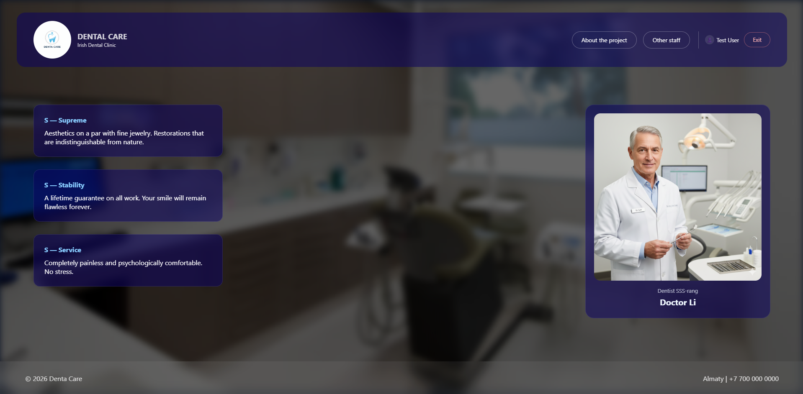
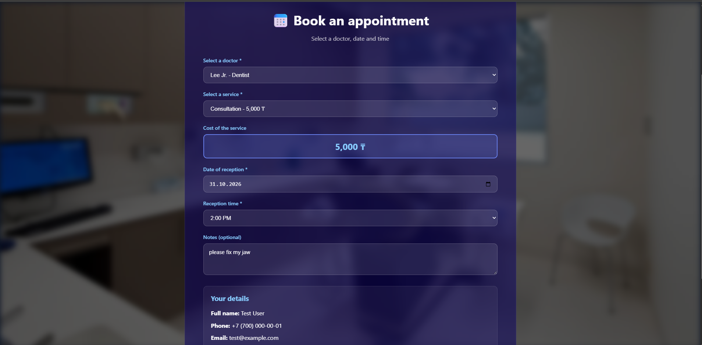

# 🦷 Denta Care

**[English](#english) | [Русский](#русский)**



---

<a name="english"></a>
## English

A website for a dental clinic with online appointment booking, payment and an admin panel. Graduation project.

**Tech stack:** HTML · CSS · vanilla JavaScript · PHP 8 · MySQL / MariaDB

### Screenshots

| Booking | Admin panel |
|---|---|
|  |  |

### Features

**Patient**
- Registration and login (passwords stored as bcrypt hashes)
- Doctors catalog with profiles, education, achievements and priced services
- Appointment booking: choose a doctor, service, date and time. Booked slots are hidden and double booking is impossible
- Card payment (demo only, see Limitations)

**Administrator**
- Separate login page (`admin-login.html`)
- View and delete users, add clients manually
- View all appointments and change their status (pending, confirmed, completed, cancelled)
- View payments

### Project structure

```
denta-care/
├── index.html, about.html, staff.html   # public pages
├── doctor*.html                         # doctor profiles
├── login.html, registration.html        # sign in / sign up
├── booking.html, payment.html           # booking and payment
├── admin-login.html, admin-panel.html   # administrator
├── style.css
├── js/                                  # page logic (fetch calls to backend/)
├── backend/                             # PHP JSON API
│   ├── db_connect.php                   # database connection (PDO)
│   ├── auth.php                         # sessions and access checks
│   ├── login.php, logout.php, register.php, verify_session.php
│   ├── get_doctors.php, get_available_slots.php
│   ├── create_appointment.php, payment.php
│   └── admin_*.php                      # administrator only
├── database/denta_care.sql              # schema and sample data
└── img/
```

### Run locally

1. Install [XAMPP](https://www.apachefriends.org/) and start **Apache** and **MySQL**.
2. Copy the project folder to `C:\xampp\htdocs\denta-care`.
3. Open `http://localhost/phpmyadmin`, go to the **Import** tab and upload `database/denta_care.sql`. The `denta_care` database is created automatically.
4. Check `backend/db_connect.php`. XAMPP defaults (`root`, empty password) work out of the box.
5. Open `http://localhost/denta-care/`.

> Open the site through `http://localhost/...`, not by double-clicking the HTML files, otherwise PHP requests and sessions will not work.
> To re-import the SQL file, delete the `denta_care` database in phpMyAdmin first.

### Demo accounts

| Role | Login | Password | Sign in at |
|---|---|---|---|
| User | `test@example.com` | `password` | `login.html` |
| Administrator | `admin` | `password` | `admin-login.html` |

These are demo credentials. Change the administrator password before any real deployment.

### Security

- **SQL injection:** all queries use PDO prepared statements.
- **Passwords:** `password_hash` (bcrypt) and `password_verify`; no plain text anywhere.
- **Access control is enforced on the server**, not in the browser. After login a PHP session is created (`HttpOnly`, `SameSite=Lax` cookie, session id regenerated on login). All `admin_*.php` endpoints return `403` without an admin session. Booking and payment require a logged-in user and are bound to that user, not to a `user_id` sent by the client.
- **Server-side validation:** email and phone format, payment amount is checked against the service price in the database, the service must belong to the chosen doctor, and users can only pay for their own appointments.
- Internal database errors are logged, never shown to the visitor.

### Limitations and ideas

- Payment is a **demo**: there is no real payment gateway, only the last 4 card digits are stored.
- No CSRF tokens (partly mitigated by `SameSite=Lax`), no login rate limiting, no email verification.
- A public deployment needs HTTPS, a dedicated database user with a password and a changed admin password.
- `localStorage` holds display data only (name, login flag). Access decisions are made by the server.
- Ideas: patient account with appointment history, cancellation by the patient, confirmation emails, migration to a framework.

*Doctor photos and the logo were generated with AI (Gemini).*

---

<a name="русский"></a>
## Русский

Сайт стоматологической клиники с онлайн-записью к врачам, оплатой и панелью администратора. Дипломная работа.

**Стек:** HTML · CSS · JavaScript (без фреймворков) · PHP 8 · MySQL / MariaDB

### Скриншоты

| Запись на приём | Панель администратора |
|---|---|
|  |  |

### Возможности

**Пациент**
- Регистрация и вход (пароли хранятся в виде bcrypt-хешей)
- Каталог врачей с профилями, образованием, достижениями и услугами с ценами
- Запись на приём: выбор врача, услуги, даты и времени. Занятые слоты скрываются, двойная запись на одно время невозможна
- Оплата услуги картой (демонстрационная, см. «Ограничения»)

**Администратор**
- Вход через отдельную страницу `admin-login.html`
- Просмотр и удаление пользователей, добавление клиентов вручную
- Просмотр всех записей и смена их статуса (ожидает, подтверждена, завершена, отменена)
- Просмотр платежей

### Структура проекта

```
denta-care/
├── index.html, about.html, staff.html   # публичные страницы
├── doctor*.html                         # профили врачей
├── login.html, registration.html        # вход и регистрация
├── booking.html, payment.html           # запись на приём и оплата
├── admin-login.html, admin-panel.html   # администратор
├── style.css
├── js/                                  # логика страниц (fetch к backend/)
├── backend/                             # PHP API (JSON)
│   ├── db_connect.php                   # подключение к БД (PDO)
│   ├── auth.php                         # сессии и проверка прав
│   ├── login.php, logout.php, register.php, verify_session.php
│   ├── get_doctors.php, get_available_slots.php
│   ├── create_appointment.php, payment.php
│   └── admin_*.php                      # только для администратора
├── database/denta_care.sql              # схема БД и тестовые данные
└── img/
```

### Запуск локально

1. Установите [XAMPP](https://www.apachefriends.org/) и запустите **Apache** и **MySQL**.
2. Скопируйте папку проекта в `C:\xampp\htdocs\denta-care`.
3. Откройте `http://localhost/phpmyadmin`, перейдите на вкладку **Импорт** и загрузите `database/denta_care.sql`. База `denta_care` создастся автоматически.
4. Проверьте `backend/db_connect.php`. Настройки XAMPP по умолчанию (`root`, пустой пароль) подходят сразу.
5. Откройте `http://localhost/denta-care/`.

> Открывайте сайт через `http://localhost/...`, а не двойным кликом по HTML-файлам: иначе не будут работать запросы к PHP и сессии.
> Чтобы импортировать SQL заново, сначала удалите базу `denta_care` в phpMyAdmin.

### Тестовые аккаунты

| Роль | Логин | Пароль | Где входить |
|---|---|---|---|
| Пользователь | `test@example.com` | `password` | `login.html` |
| Администратор | `admin` | `password` | `admin-login.html` |

Это учебные данные. Перед любым реальным запуском смените пароль администратора.

### Безопасность

- **SQL-инъекции:** все запросы идут через подготовленные выражения PDO.
- **Пароли:** `password_hash` (bcrypt) и `password_verify`, открытого текста нигде нет.
- **Права доступа проверяет сервер**, а не браузер. После входа создаётся PHP-сессия (cookie `HttpOnly`, `SameSite=Lax`, id сессии обновляется при входе). Все `admin_*.php` отвечают `403` без сессии администратора. Запись и оплата требуют входа и привязаны к пользователю из сессии, а не к `user_id` из запроса.
- **Валидация на сервере:** формат email и телефона, сумма платежа сверяется с ценой услуги в БД, услуга должна принадлежать выбранному врачу, оплачивать можно только свои записи.
- Внутренние ошибки БД пишутся в лог и не показываются посетителю.

### Ограничения и идеи

- Оплата **демонстрационная**: реального платёжного шлюза нет, сохраняются только последние 4 цифры карты.
- Нет CSRF-токенов (частично компенсируется `SameSite=Lax`), ограничения числа попыток входа и подтверждения email.
- Для публикации в интернете нужны HTTPS, отдельный пользователь БД с паролем и смена пароля администратора.
- В `localStorage` хранятся только данные для отображения (имя, флаг входа). Решения о доступе принимает сервер.
- Идеи: личный кабинет пациента с историей записей, отмена записи пользователем, письма-подтверждения, перенос на фреймворк.

*Фотографии врачей и логотип сгенерированы с помощью ИИ (Gemini).*
